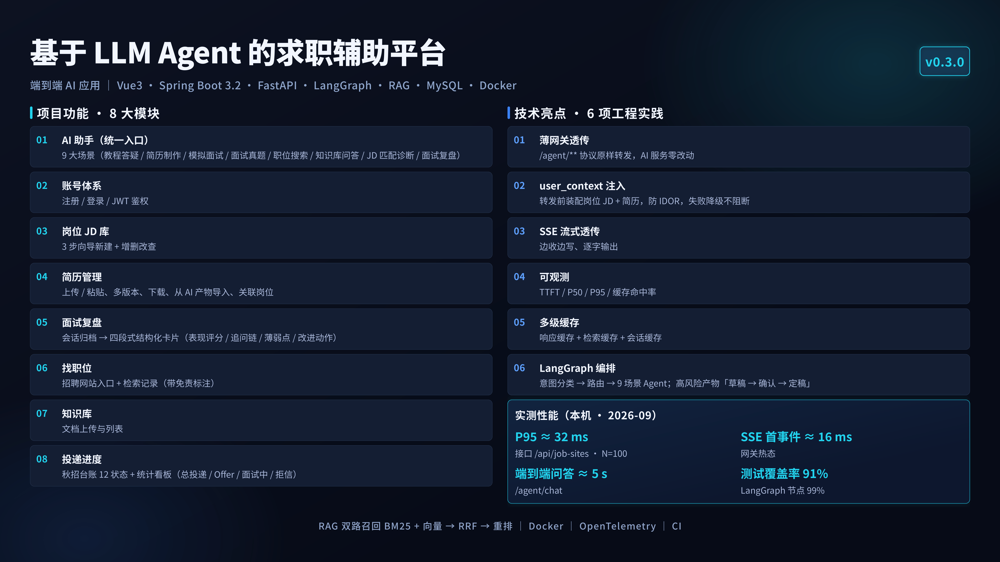

# AI 求职助手（jobseeker）

> 当前版本 **v0.3.0**



参照 OfferGoose 的求职辅助软件，**内嵌现有 Python Agent 作为独立的「AI 助手」**。

核心分工：**Agent 负责"生成"，本软件负责"存、管、看"**。

## 设计原则

- **Agent 的 9 个能力一律不重新实现**（教程 / 答疑 / 简历 / 面试真题 / 模拟面试 / 职位搜索 / 知识库问答 / JD 匹配诊断 / 面试复盘），
  全部收归「AI 助手」页，Java 只做**薄网关透传**。
- **薄网关的唯一加工点：装配用户画像**。调用 Agent 前，按登录用户把「所选岗位 + 关联简历」拼装为 `user_context` 注入 `/agent/chat` 与 `/agent/chat/stream`，让 Agent 直接"认识"用户岗位与简历。
- **Agent 代码零改动**，只通过 HTTP / SSE 调用。
- **不含会员功能**（无套餐、无次数扣减、无支付）。
- 与 Agent 工程**平行存放**：`../Agent实习项目`（Python）与 `jobseeker`（Java + Vue）互不污染。

## 本软件做什么（Agent 没有的能力）

| 模块 | 说明 |
|---|---|
| 账号 | 注册 / 登录 / JWT 鉴权 |
| 岗位 JD 库 | 3 步向导新建、列表、详情、编辑、删除 |
| 简历文件管理 | 上传 / 粘贴 / 版本 / 下载 / 删除 / 从 AI 产物导入 |
| 面试归档与复盘 | 调 Agent `/sessions/{id}` 单向只读归档；**复盘升级为四段式结构化卡片**（表现评分环形指标 / 追问链步骤条 / 薄弱点 / 改进动作），解析失败自动回退旧版「建议 / 弱点」 |
| **JD 匹配评分卡** | 关联岗位 + 简历后，把 Agent 的结构化产物渲染为 环形总分 + 分项进度条 + 命中/缺口双栏 + 面试准备重点 |
| **工具调用时间线** | 把 SSE `tool_call` 事件渲染为可折叠时间线（工具名 / 耗时 / 入参摘要 / 返回摘要），过程可追溯 |
| 职位搜索记录 | 保存检索与结果（`source=agent` 强制带免责说明） |
| 知识库文档 | 上传文档归属与列表（建库问答在 Agent 侧） |
| 招聘网站入口 | 站点配置 + 安全外链拼接 |
| 投递进度管理 | 秋招投递台账：列表增删改、12 状态枚举 + 面试轮次、关联岗位/简历、后端聚合统计看板（总投递 / Offer / 面试中 / 拒信 与 状态 / 城市 / 渠道分布） |
| 网关可观测 | TTFT / P95 / 缓存命中率 + **工具调用次数与耗时分布**（`GET /agent/gateway-metrics`） |

## AI 助手上下文注入（user_context）

「AI 助手」不是裸 Agent，而是网关在调用前为用户装配好背景：

1. 用户在「AI 助手」页选择**岗位**与**关联简历**（前端 `assistant` 视图的模式选择器与简历下拉）。
2. 后端 `AgentContextService` 校验二者归属当前用户后，查库取出岗位 JD 与简历正文（截断）拼装为 `user_context`。
3. 网关把 `user_context` 随请求注入 `/agent/chat`、`/agent/chat/stream`；Agent 侧 `SessionManager` 在每轮以 `SystemMessage` 前置注入会话（历史裁剪后画像不丢）。

效果：模拟面试 / 简历制作 / 职位搜索等能力能直接结合用户岗位与简历作答；`user_context` 为空时行为与旧版一致。

## 数据库迁移（Flyway）

改表结构**一律新增 `server/src/main/resources/db/migration/V<n>__<描述>.sql`** ✓✓ —— 不要再手工改库 ✗、不要再往 `db/legacy/` 加脚本 ✗。

| 文件 | 内容 |
| --- | --- |
| `db/migration/V1__init_schema.sql` | 全量建表（11 张表） |
| `db/migration/V2__add_delivery_exam_done.sql` | `delivery_record.exam_done` |
| `db/migration/V3__add_delivery_exam_deadline_and_apply_url.sql` | `exam_deadline` + `apply_url` |
| `db/migration/V4__add_list_indexes.sql` | 五个 `(user_id, created_at)` 联合索引 |
| `db/legacy/` | **已废弃**的手工脚本，保留仅作对账（含为什么废弃的说明） |

执行状态记录在 `flyway_schema_history` 表，随时可查 ✓：

```sql
SELECT version, description, success, installed_on
FROM jobseeker.flyway_schema_history ORDER BY installed_rank;
```

**已有库不会重跑** ✓✓ —— `baseline-version: 4` 表示"库已到 V4 状态" ✓，
全新库则从 V1 顺序执行 ✓✓，最终结构**必然一致** ✓（这正是手工方案做不到的 ✓）。

### 写迁移文件的两条硬规矩（都是真机踩出来的 ✗）

1. **注释里不要写英文分号** ✗✗ —— Flyway 先按分号切语句、再剥注释，
   注释里的 `USE jobseeker;` 会把 SQL 截断，报错还指向下一行 ✗✗
2. **不要写 `USE <库名>`** ✗ —— Flyway 已把会话切到目标库 ✗；
   同理不能自己 `CREATE DATABASE` ✓（切临时库做演练时会把 DDL 打到同名库上 ✗）

更多取舍与踩坑见 [`docs/DEV_NOTES.md`](docs/DEV_NOTES.md) 的 2026-10-17 小节。

## 缓存 / 分布式锁 / 限流（Redis 三件套，默认关闭）

后端对 Agent 的三项保护能力，**默认全部不启用 Redis**：不装 Redis 的机器照常启动，
三项各自降级为进程内实现，并在启动日志里明确写出当前后端（不会静默降级 ✗）。

| 能力 |  Redis 版 | 降级版（Redis 不可用时） | 解决什么问题 |
| --- | --- | --- | --- |
| 响应缓存 | `RedisChatCache`（TTL，跨实例共享） | `ChatResponseCache`（进程内 LRU） | 相同 query 直接命中，省掉整轮 Agent/LLM 调用 |
| 分布式锁 | `RedisLock`（`SET NX EX` + Lua 原子释放） | `LocalLock`（进程内 `ReentrantLock`） | 缓存击穿：并发同 key 只放一个去问 Agent，其余等它回写后命中 |
| 接口限流 | `RedisRateLimiter`（`INCR`+`EXPIRE` 一段 Lua） | `LocalRateLimiter`（进程内固定窗口） | 单个用户打满会拖垮所有人并烧光 LLM 配额；超限返回 429 + `Retry-After` |

配置（`server/src/main/resources/application.yml`，默认值如下）：

```yaml
agent:
  redis:
    enabled: false          # true 才装配 Redis 连接（不建连接 = 启动零噪音）
    host: 127.0.0.1
    port: 6379
    password:
    key-prefix: jobseeker:
    health-check-seconds: 30   # 故障后按此间隔尝试自动恢复
  rate-limit:
    enabled: true           # 注意：这是"限流功能"开关，与 Redis 无关
    window-seconds: 60
    max-requests: 60
    per-user: true          # false 则按来源 IP
```

打开方式：装好 Redis 后把 `agent.redis.enabled` 改为 `true`（或用环境变量
`AGENT_REDIS_ENABLED=true`），重启即可，无需改代码。

**观察当前实际后端**（降级是静默的，必须给观察口 ✗）：

```powershell
curl http://127.0.0.1:8080/agent/backends
# {"redisEnabled":false,"redisHealthy":false,"cache":"memory","lock":"local","rateLimit":"local"}
```

三个刻意的取舍（面试常被追问，先说清）：

1. **缓存不做空值防穿透**：缓存值是「一次完整的 LLM 回答」而不是数据库行，
   未命中的真正开销由分布式锁兜底，再叠空值标记收益接近零；
2. **锁不上看门狗 / 不做红锁**：单机 Redis + 演示规模下，Redlock 的代价大于收益；
   临界区必须远短于 TTL，这一点写在接口注释里；
3. **限流是固定窗口**：Redis 侧一次 `INCR` 成本最低，代价是窗口边界可能两倍突发；
   要更严格可换令牌桶，接口不变。

## 目录

```
jobseeker/
├── server/                  # Java 后端 Spring Boot 3.2.5（分层 Controller/Service/Mapper）
│   ├── src/main/java/com/jobseeker/cache/       # 响应缓存：接口 + Redis 版 + 进程内版 + 降级路由
│   ├── src/main/java/com/jobseeker/lock/        # 分布式锁：SET NX EX + Lua 释放 + 进程内降级
│   ├── src/main/java/com/jobseeker/ratelimit/   # 限流：INCR+EXPIRE Lua + 进程内降级 + 拦截器
│   ├── src/main/java/com/jobseeker/redis/       # Redis 可用性探测（三件套共用一份）
│   └── src/test/java/com/jobseeker/             # 单测：49 条（JUnit5 + Mockito，无需 Redis/MySQL）
│   └── src/main/resources/db/
│       ├── migration/        # Flyway 迁移（**改表结构只加这里的 V<n>__*.sql**）
│       ├── legacy/           # 已废弃的手工脚本（保留仅作对账）
│       └── schema.sql        # 仅供人工建库/对账，权威路径是 migration/
├── web/                     # Vue 3 + Vite + tdesign + Tailwind
├── .mvn/local-settings.xml.example   # 本地 Maven 配置模板（复制为 server/.mvn/local-settings.xml 后使用，不进库）
├── docker-compose.yml       # 编排 mysql + server + web
├── start-all.ps1            # 先起 Agent 再起本软件
├── start-backend.bat        # Windows 一键重启后端（按端口杀旧进程再 mvn spring-boot:run）
├── scripts/                 # 运维脚本（如网关压测 bench-gateway.ps1）
└── docs/
    ├── ARCHITECTURE.md      # 架构与关键决策
    ├── API_CONTRACT.md      # 前后端 + 后端↔Agent 接口契约
    └── DEPLOY.md            # 部署步骤与已知坑
```

跑测试（JDK 17，本机约 10 秒，不需要 Redis / MySQL）：

```powershell
cd server
mvn -s .mvn/local-settings.xml test
```

## 快速开始

### 一键启动（推荐）

```powershell
.\start-all.ps1                 # 有 Docker → docker compose；无 Docker → 本机进程（Agent :8000/:8501 + 后端 :8080 + 前端 :5173）
.\start-all.ps1 -SkipWeb        # 只起 Agent + 后端
.\start-all.ps1 -Mode local     # 强制本机进程方式（-Mode docker 反之）
.\stop-all.ps1                  # 停止本次启动的进程；-Force 连同占用这四个端口的一起停
```

它比手敲多做了几件事：**前置检查**（JDK 17 / Maven / Node / MySQL 缺哪个当场说清）→ **幂等**（已在监听的端口直接跳过，不重复起进程）→ 日志集中到 `_runlogs\`、失败自动打印尾部 → 启动完再读一次 `/health`，模型额度或网络不通时会明确告诉你「服务已起，但 AI 回答会走降级」，而不是对着空回答猜。前端首次启动若被安全软件打断依赖预构建（esbuild 退出），脚本会清 `node_modules/.vite` 自动重试一次。

> 本机若没有容器运行时（如当前开发机），脚本会自动走本机进程方式，无需手动改。

### 手动分步（等价，便于排查）

```powershell
# 1) 先起 Python Agent（在平行目录）
cd ..\Agent实习项目
.\run_api.ps1

# 2) 建库
# 建一个空库即可，表结构由应用启动时的 Flyway 自动完成（见「数据库迁移」一节）✓✓：
#   mysql -u root -p -e "CREATE DATABASE jobseeker DEFAULT CHARACTER SET utf8mb4 COLLATE utf8mb4_unicode_ci;"
# 下面这条是**纯手工**路径（不含 V2~V4 的增量列 ✗），只在排查时用：
# mysql -u root -p < server/src/main/resources/db/schema.sql

# 3) 起后端（JDK 17） —— 新开一个终端、回到 jobseeker 目录后进入 server
cd jobseeker\server
$env:JAVA_HOME = "C:\Program Files\Java\jdk-17"
# 首次需准备本地 Maven 配置：把仓库根模板复制为 server/.mvn/local-settings.xml，并按本机改 localRepository 路径（不进版本库）
copy ..\.mvn\local-settings.xml.example .mvn\local-settings.xml
mvn -s .mvn/local-settings.xml spring-boot:run

# 4) 起前端
cd ..\web
npm install --registry=https://registry.npmmirror.com
npm run dev
```

> **Windows 本机构建坑（D: 盘重命名被拦）**：部分环境 D: 盘禁止文件重命名，会导致 Maven 资源拷贝
> `AccessDeniedException`（以及 Safe-Delete 拒绝删除 `target`）。已由 `server/pom.xml` 的
> `windows-safe-delete` profile 把**资源输出**改到 `C:/jobseeker-target/classes`（编译产物仍留在项目内 `target`）；
> 也可用仓库根目录的 `start-backend.bat` 一键重启（按端口杀旧进程再 `mvn spring-boot:run`）。

详见 [`docs/DEPLOY.md`](docs/DEPLOY.md)。

## 重要提醒

- **AI 职位清单不是真实职位**：Agent 的联网检索当前不可用（`ENABLE_WEB_SEARCH=false`
  且 DuckDuckGo 超时），职位搜索结果本质是模型推断，界面**强制展示免责标注且不渲染链接**。
- **Agent 接口没有 `/api` 前缀**：真实路径是 `/chat`、`/knowledge`、`/sessions`（旧文档有误，已修正）。
- **AI 生成内容免责**：助手对话、面试复盘（建议 / 弱点）、简历产物、AI 职位方向等均为 AI 生成，
  界面强制展示"内容由 AI 生成，仅供参考"，请勿直接当作权威结论。
- **`/agent/**` 需登录态**：AI 助手网关已纳入登录拦截（`AuthInterceptor` 覆盖 `/agent/**`），
  未登录会被拦截——这也是网关注入 `user_context` 的前提（需先拿到当前用户）。
- **主键（雪花 ID）统一按字符串下发**：19 位 Long 超出 JS `Number` 安全整数范围，按数字下发会被
  四舍五入（`...587778` → `...587800`），回传时 ID 已经错了、`user_context` 会**静默**注入失败。
  已由 `config/JacksonConfig.java` 全局把 `Long` 序列化为字符串（`int` 不受影响，`Result.code` 仍是数字）；
  前端所有 ID 一律当字符串透传，不做数值运算。
- **SSE 事件类型**：`session` / `delta` / `tool_call`（工具调用过程）/ `done`（含 `tool_events` 与结构化产物 `structured`）；
  长结构化调用期间每 15s 发一条 `: keep-alive` 注释，避免被网关 OkHttp 的 120s 读超时掐断。
- **前端构建产物不入库**：`npm run build` 的 postbuild 会把 `web/dist` 复制到 `server/src/main/resources/static/`
  （仅供 `:8080` 直接服务 UI），其中 `assets/` 与 `index.html` 已在 `.gitignore` 中忽略；`static/icons/` 是站点图标源码，需保留。
